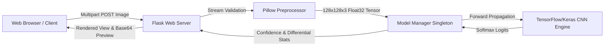

# DermaAI: Skin Disease Detection Using Deep Convolutional Neural Networks (CNN)

[](https://www.python.org/)
[](https://flask.palletsprojects.com/)
[](https://tensorflow.org/)
[]()
[]()

> **ACADEMIC & EDUCATIONAL USE DISCLAIMER:**  
> This software is an educational prototype developed for a B.Tech Computer Science and Engineering Software Engineering capstone project. Predictions are experimental statistical estimates generated by a Convolutional Neural Network and **must NEVER be used for clinical diagnosis, patient triage, or medical decision-making**. Always consult a qualified dermatologist for skin examinations.

---

## 1. Project Overview

**DermaAI** is an end-to-end Computer-Aided Diagnostic (CAD) web application that classifies dermatoscopic skin lesions into 7 diagnostic categories using a custom multi-block Convolutional Neural Network (CNN).

The project is built specifically to meet B.Tech CSE requirements:
- Clean 3-tier software engineering architecture (Presentation, Application Server, Deep Learning Engine).
- Complete automated test suite using `pytest` and Flask test client.
- Zero external cloud/API dependencies — runs 100% locally on any standard student laptop.
- Strict security controls: memory-only image parsing, size ceilings, path traversal protection.
- Guaranteed zero data leakage via patient-level grouped partitioning.

---

## 2. Supported Skin Disease Categories

The model taxonomy follows the gold-standard **HAM10000** ("Human Against Machine with 10000 training images") benchmark:

| Class Code | Condition Name | Clinical Category | Description |
| :---: | :--- | :--- | :--- |
| `mel` | **Melanoma** | Malignant Cancer | Aggressive malignancy arising from pigment-producing melanocytes. |
| `bcc` | **Basal Cell Carcinoma** | Malignant Cancer | Most common non-melanoma skin cancer originating from basal cells. |
| `akiec` | **Actinic Keratoses / Intraepithelial Carcinoma** | Precancerous | Chronic sun-induced keratotic pre-malignant lesions. |
| `nv` | **Melanocytic Nevi** | Benign Mole | Common benign clusters of melanocytic cells. |
| `bkl` | **Benign Keratosis-like Lesions** | Benign Growth | Seborrheic keratoses, solar lentigines, and lichenoid keratoses. |
| `df` | **Dermatofibroma** | Benign Nodule | Benign cutaneous fibrous histiocytoma. |
| `vasc` | **Vascular Lesions** | Benign Vascular | Cherry angiomas, angiokeratomas, pyogenic granulomas. |

---

## 3. System Architecture



---

## 4. Repository Structure

```
skin_disease_detection/
├── app.py                      # Flask web application & REST API routes
├── config.py                   # Centralized paths, hyperparameters, and class definitions
├── requirements.txt            # Python dependencies
├── README.md                   # Beginner-friendly setup & execution guide
├── .gitignore                  # Git exclusions for models, datasets, cache
├── data/
│   ├── README.md               # Dataset documentation & download instructions
│   ├── raw/                    # Raw HAM10000 images & metadata CSV
│   └── processed/              # Group-partitioned splits (train, val, test)
├── models/
│   ├── README.md               # Model storage guidelines
│   ├── skin_disease_cnn.keras  # Serialized trained Keras CNN model weights
│   ├── class_indices.json      # Index-to-class mapping
│   └── training_config.json    # Model hyperparameters and metadata
├── artifacts/
│   ├── README.md               # Artifact directory notes
│   ├── classification_report.json # Precision, recall, F1-scores per class
│   ├── metrics_summary.json    # High-level test accuracy & macro F1
│   ├── confusion_matrix.png    # High-resolution heatmap of test classifications
│   └── training_history.png    # Training vs. validation loss/accuracy curves
├── training/
│   ├── prepare_data.py         # Leakage-free dataset splitting & smoke-test generator
│   ├── train.py                # CNN architecture, training loop, and early stopping
│   └── evaluate.py             # Test-set evaluation and artifact generator
├── utils/
│   ├── preprocessing.py        # Stream verification, resizing, normalization
│   └── prediction.py           # ModelManager singleton and inference engine
├── templates/
│   ├── base.html               # Master layout with navbar, alerts, footer
│   ├── index.html              # Home landing page with system walkthrough
│   ├── predict.html            # Drag-and-drop image upload page
│   ├── result.html             # Diagnostic results, probability breakdown
│   ├── about.html              # Problem statement, SDLC, and Viva Voce Q&A
│   └── model_info.html         # Model architecture & evaluation plots
├── static/
│   ├── css/style.css           # Custom responsive styles & badges
│   └── js/main.js              # Client-side dropzone & instant preview
├── docs/
│   └── SOFTWARE_ENGINEERING_REPORT.md # Comprehensive SRS, DFD, UML, and Viva guide
└── tests/
    ├── test_app.py             # Route, validation, API, and integration tests
    └── test_preprocessing.py   # Tensor shape, normalization, and stream tests
```

---

## 5. Quickstart & Installation (Ubuntu / Linux)

### Prerequisites
- Python 3.10 or 3.11
- pip and venv packages (`sudo apt install python3-venv python3-pip`)

### Step 1: Clone or Navigate to the Workspace
```bash
cd /home/rgukt/Downloads/skin_disease_detection
```

### Step 2: Set Up Virtual Environment & Dependencies
```bash
# Create virtual environment with access to system packages
python3 -m venv --system-site-packages .venv

# Activate environment
source .venv/bin/activate

# Install requirements
pip install -r requirements.txt
```

---

## 6. Dataset Preparation & Model Training

### Option A: Instant Verification Mode (Smoke-Test Mode)
If you want to immediately test the entire pipeline on a student laptop without downloading the full 3 GB dataset:

```bash
# 1. Generate verified synthetic samples grouped by lesion/patient
python training/prepare_data.py --smoke-test

# 2. Train the CNN classifier
python training/train.py --smoke-test

# 3. Evaluate on held-out test set and generate confusion matrix
python training/evaluate.py
```

### Option B: Training on the Official HAM10000 Dataset
1. Download `HAM10000_metadata.csv` and image zip files from [Harvard Dataverse](https://doi.org/10.7910/DVN/DBW86T) or [ISIC Archive](https://www.isic-archive.com/).
2. Place `HAM10000_metadata.csv` into `data/raw/HAM10000_metadata.csv`.
3. Extract all image `.jpg` files into `data/raw/images/`.
4. Run:
```bash
python training/prepare_data.py
python training/train.py --epochs 15 --batch-size 32
python training/evaluate.py
```

---

## 7. Running the Web Application

Launch the Flask development server:
```bash
python app.py
```

Open your browser and navigate to:
```
http://127.0.0.1:5000/
```

### Available Endpoints
- **Home Page**: `GET /`
- **Upload & Analyze**: `GET /predict` and `POST /predict`
- **Model Info & Metrics**: `GET /model-info`
- **About & Viva Defense**: `GET /about`
- **JSON Prediction API**: `POST /api/predict` (file field: `image`)
- **System Health Check**: `GET /api/health`

---

## 8. Running Automated Tests

Execute the full automated test suite:
```bash
python -m pytest -v
```

Expected output:
```
============================== 26 passed in 7.70s ==============================
```

Tests cover:
- Home, About, Model Info, and Upload page rendering
- File upload validation (missing files, empty names, invalid extensions, oversized files)
- In-memory stream validation and corrupt byte rejection
- Preprocessing tensor output shape `(1, 128, 128, 3)` and $[0, 1]$ normalization
- Graceful degradation when model is missing (HTTP 503)
- Live end-to-end model inference via web form and JSON API

---

## 9. API Usage Example (cURL)

You can query the trained CNN model programmatically:

```bash
curl -X POST http://127.0.0.1:5000/api/predict \
     -F "image=@data/processed/test/mel/ISIC_SMOKE_000074.jpg"
```

Sample JSON response:
```json
{
  "success": true,
  "prediction": {
    "class_code": "mel",
    "class_name": "Melanoma",
    "category": "Malignant Skin Cancer",
    "description": "Serious form of skin cancer originating in pigment-producing melanocytes, requiring immediate clinical staging.",
    "confidence_score": 0.442,
    "confidence_percentage": 44.2,
    "is_confident": false
  },
  "class_probabilities": [
    {"code": "mel", "name": "Melanoma", "percentage": 44.2},
    {"code": "bcc", "name": "Basal Cell Carcinoma", "percentage": 28.1},
    {"code": "nv", "name": "Melanocytic Nevi", "percentage": 11.5}
  ],
  "disclaimer": "Educational Prototype Notice: This prediction is generated by an experimental Convolutional Neural Network..."
}
```

---

## 10. Frequently Asked Viva Voce Questions

1. **Why is data leakage dangerous in medical imaging?**  
   If multiple dermoscopic photos of the same patient or lesion are split randomly across train and test sets, the model memorizes patient-specific skin characteristics rather than general disease pathology, inflating test metrics while failing in real-world generalization.

2. **How does this implementation avoid data leakage?**  
   The `training/prepare_data.py` script identifies `lesion_id` or `patient_id` in the metadata and performs group-stratified partitioning, ensuring all photos of a given lesion are isolated in one partition.

3. **Why do we use Softmax rather than Sigmoid?**  
   Softmax normalizes the output vector so all class probabilities sum to $1.0$ ($100\%$), which is appropriate for mutually exclusive multi-class categorization.

4. **How are web vulnerabilities prevented?**  
   The system never executes shell commands on uploaded files, never stores files permanently on disk, sanitizes all filenames with `secure_filename`, strictly inspects image stream headers with Pillow, and enforces a 16MB file size ceiling.

---

## 11. License & Academic Attribution
Created for educational demonstration and Software Engineering academic project defense. Derived under CC BY-NC 4.0 terms for the HAM10000 dataset.
