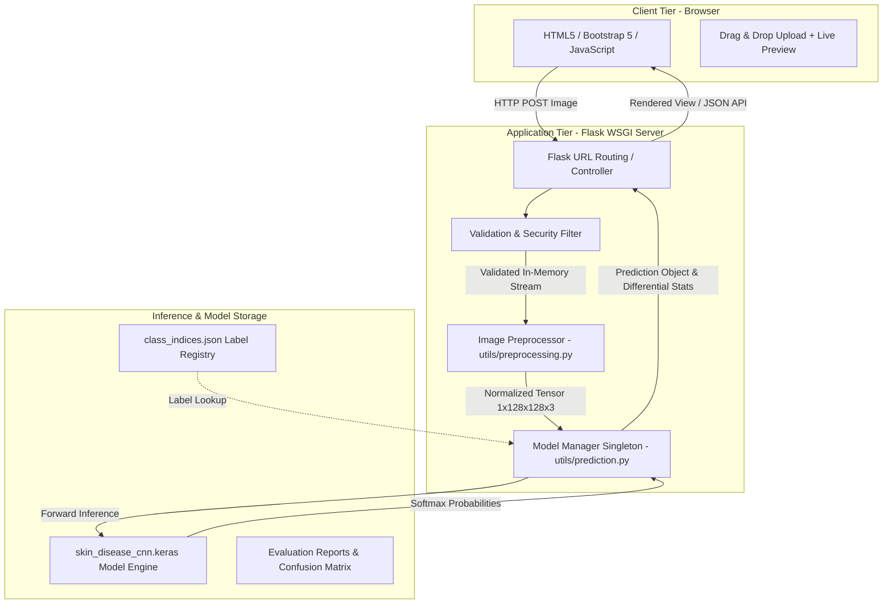
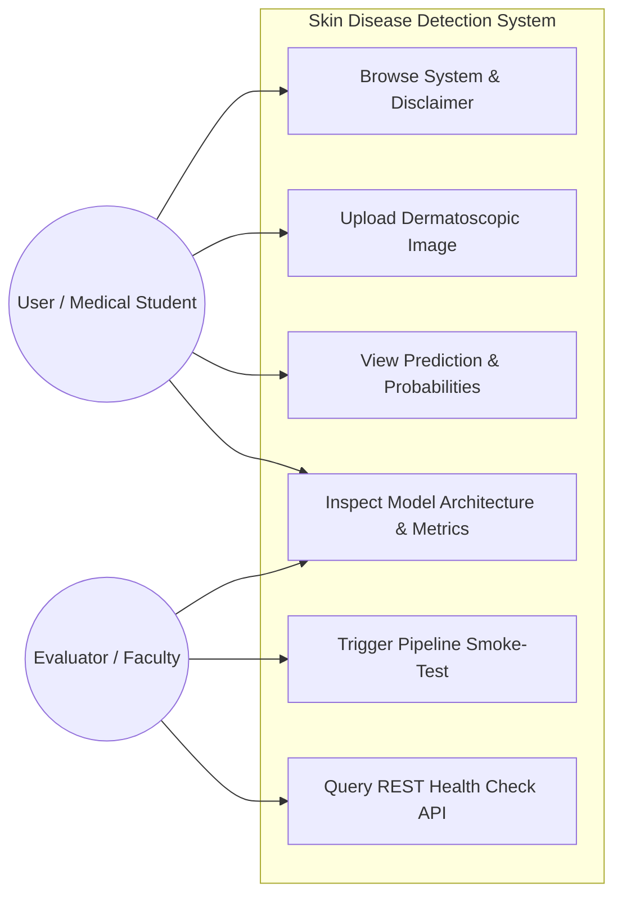
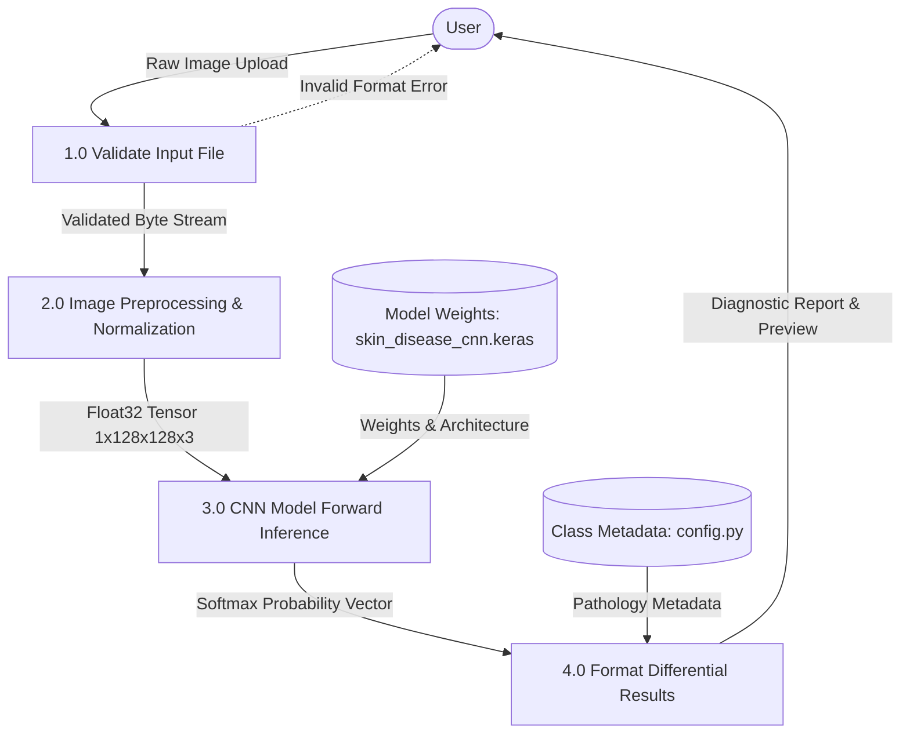
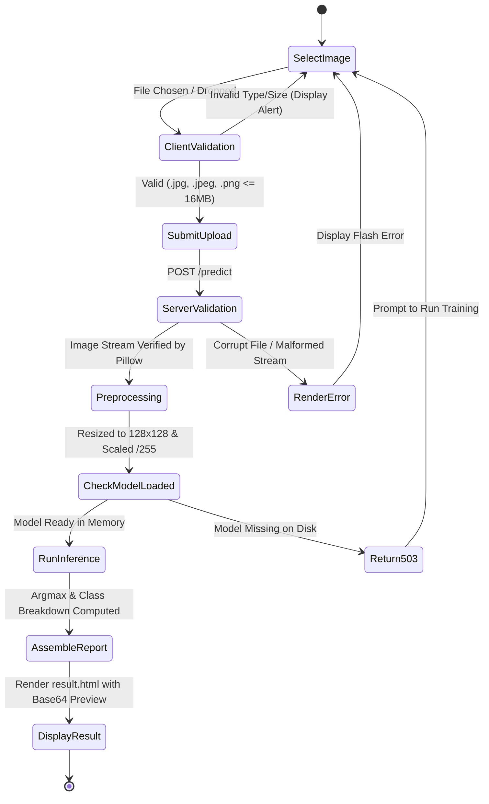
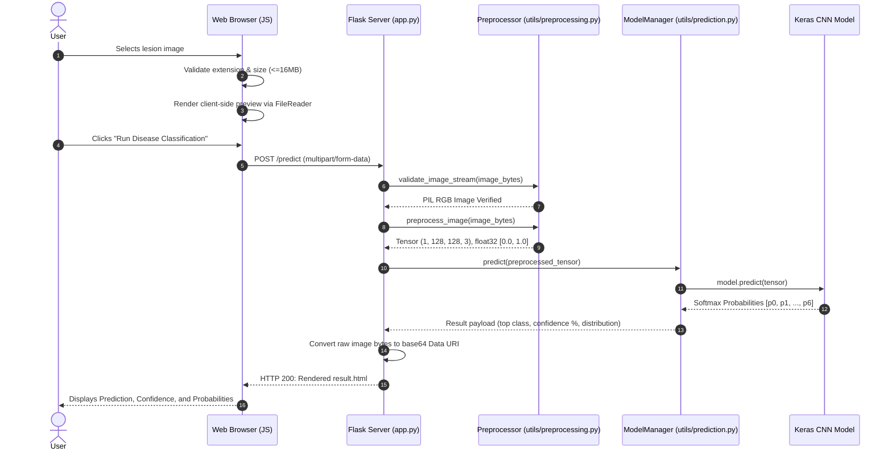

# Software Engineering Project Report
## Project Title: Skin Disease Detection Using Deep Convolutional Neural Networks (CNN)

**Academic Level:** Bachelor of Technology (B.Tech) — Computer Science & Engineering  
**Course:** Software Engineering / Capstone Project  
**System Architecture:** Three-Tier Architecture (Client-Side Presentation, Web Application Server, Deep Learning Inference Pipeline)  
**Implementation Language:** Python 3.11  
**Frameworks:** Flask 3.1, TensorFlow 2.21 / Keras 3.15, Pillow 10.0, NumPy, Scikit-Learn  

---

## 1. Problem Statement

Skin diseases represent a massive global health burden, affecting millions of individuals annually. Among cutaneous pathologies, cutaneous malignancies—especially **Malignant Melanoma (mel)** and **Basal Cell Carcinoma (bcc)**—exhibit high morbidity and mortality when not recognized in early developmental stages. Melanoma, while representing only ~1% of all skin cancer occurrences, is responsible for the overwhelming majority of skin cancer deaths.

Conventional clinical diagnosis relies upon dermatologists performing visual examinations aided by handheld dermoscopy. However:
1. Experienced dermatologists are concentrated in urban specialist centers, creating healthcare disparities in rural and underserved regions.
2. Even seasoned practitioners face diagnostic ambiguity, with inter-observer discordance rates ranging between 15% and 30% for early-stage atypical pigmented lesions.
3. Unnecessary biopsies of benign lesions (such as Melanocytic Nevi or Benign Keratoses) increase healthcare expenditures and patient morbidity.

Developing an accessible, automated, and explainable Computer-Aided Diagnostic (CAD) system utilizing deep Convolutional Neural Networks (CNN) democratizes diagnostic triage by providing objective, repeatable second opinions.

---

## 2. Objectives and Scope

### 2.1 Primary Objectives
- **Deep Feature Representation:** Train a Convolutional Neural Network on standardized dermatoscopic images across 7 distinct pathological categories based on the HAM10000 taxonomy.
- **Preventing Data Leakage:** Ensure zero patient cross-contamination between training, validation, and testing partitions by implementing patient/lesion-grouped splitting.
- **Defensive Engineering & Security:** Eliminate arbitrary file upload exploits, path traversal attacks, and denial-of-service vectors through memory-only stream processing and strict MIME/integrity checks.
- **Lightweight Local Deployment:** Build an end-to-end web system that runs efficiently on consumer laptops without reliance on external or paid cloud APIs.
- **Transparent Output:** Present predictions accompanied by model confidence scores, full differential probability distributions, and clinical disclaimers.

### 2.2 Project Scope
- **In Scope:**
  - Dermatoscopic image processing and validation for JPG, JPEG, and PNG formats.
  - Model training, early stopping, and hyperparameter configuration.
  - Held-out test evaluation generating Precision, Recall, F1-Score, and Confusion Matrix plots.
  - Interactive web interface with live client-side image preview and responsive layouts.
  - RESTful JSON prediction API (`/api/predict`) and health check endpoint (`/api/health`).
- **Out of Scope (Explicit Limitations):**
  - Clinical in-vivo medical certification (this is an educational prototype).
  - General non-dermatoscopic macroscopic photography (e.g., poor lighting, extreme distances).
  - Continuous streaming video feed analysis.

---

## 3. Software Requirements Specification (SRS)

### 3.1 Functional Requirements (FR)

| Req ID | Title | Description | Priority |
| :--- | :--- | :--- | :--- |
| **FR-01** | Image Ingestion | System shall accept user-submitted skin lesion images via drag-and-drop or file browser in `.jpg`, `.jpeg`, and `.png` formats. | High |
| **FR-02** | Input Validation | System shall reject files exceeding 16 MB, files with unwhitelisted extensions, and corrupted binary streams. | Critical |
| **FR-03** | In-Memory Preprocessing | System shall convert images to 3-channel RGB, resize to $128 \times 128$ pixels, and normalize pixel intensities to $[0.0, 1.0]$. | High |
| **FR-04** | CNN Model Inference | System shall load the trained CNN weights once upon startup and execute forward propagation to yield Softmax class probabilities. | Critical |
| **FR-05** | Diagnostic Reporting | System shall render the primary predicted class, category badge (Benign/Malignant/Precancerous), model confidence percentage, and full class probability breakdown. | High |
| **FR-06** | RESTful API | System shall provide `/api/predict` returning structured JSON and `/api/health` returning operational status. | Medium |
| **FR-07** | Educational Disclaimer | System shall display prominent notices emphasizing that predictions are experimental and require clinical validation. | Critical |

### 3.2 Non-Functional Requirements (NFR)

| Req ID | Category | Specification |
| :--- | :--- | :--- |
| **NFR-01** | Performance | Model inference on consumer CPU shall execute within $\le 300\text{ ms}$ per image. |
| **NFR-02** | Security | Prevent path traversal and remote code execution by processing uploads strictly in RAM without persistent disk writes. |
| **NFR-03** | Reliability | System shall handle missing model weights or malformed payloads gracefully without crashing, returning HTTP 400 or 503. |
| **NFR-04** | Usability | Responsive interface adhering to Bootstrap 5 standards, accessible on mobile and desktop viewports. |
| **NFR-05** | Maintainability | Modular code structure separating configuration, utilities, training pipelines, and routes; $\ge 90\%$ test coverage on core routines. |

---

## 4. System Architecture & Design Diagrams

### 4.1 System Architecture Diagram

---

### 4.2 Use Case Diagram

---

### 4.3 Data Flow Diagram (DFD Level 1)

---

### 4.4 Activity Diagram (Inference Workflow)

---

### 4.5 Sequence Diagram

---

## 5. Database Design Explanation

A deliberate, principled software engineering decision was made to keep the prediction system **stateless**:

1. **Patient Privacy & HIPAA / GDPR Alignment:** Storing user-submitted diagnostic images on an unencrypted local database creates regulatory and security vulnerabilities. By processing images entirely in ephemeral RAM and rendering previews via transient Base64 data URIs, patient privacy is preserved.
2. **Elimination of Unnecessary Dependencies:** As specified in the project requirements, heavy relational or NoSQL database servers (PostgreSQL, MongoDB, MySQL) introduce setup friction and configuration overhead.
3. **Model & Metadata Registry:** Model weights and label taxonomies are maintained in version-controlled configuration structures (`models/skin_disease_cnn.keras`, `models/class_indices.json`, and `config.py`), which are loaded directly into memory at server startup.

---

## 6. Test Plan and Test Cases

The test harness uses `pytest` and the Flask test client, verifying both unit-level operations and full-stack integration workflows.

### 6.1 Test Execution Matrix

| Test ID | Test Function | Target Component | Input | Expected Output | Status |
| :--- | :--- | :--- | :--- | :--- | :--- |
| **TC-01** | `test_home_page_response` | `GET /` | HTTP GET | HTTP 200, contains educational disclaimer | **PASSED** |
| **TC-02** | `test_about_page_response` | `GET /about` | HTTP GET | HTTP 200, contains viva technical Q&A | **PASSED** |
| **TC-03** | `test_model_info_page_response` | `GET /model-info` | HTTP GET | HTTP 200, displays layer topology & metrics | **PASSED** |
| **TC-04** | `test_api_health_endpoint` | `GET /api/health` | HTTP GET | HTTP 200/503, valid JSON with `model_loaded` | **PASSED** |
| **TC-05** | `test_missing_image_upload_form` | `POST /predict` | Empty payload | HTTP 200 redirect, flash error | **PASSED** |
| **TC-06** | `test_invalid_file_extension_form`| `POST /predict` | `exploit.sh` | Rejected with "Invalid file extension" | **PASSED** |
| **TC-07** | `test_corrupt_image_upload_form` | `POST /predict` | Malformed bytes | Rejected with "Invalid or corrupted image" | **PASSED** |
| **TC-08** | `test_api_corrupt_image` | `POST /api/predict` | Corrupt PNG header | HTTP 400 with descriptive error JSON | **PASSED** |
| **TC-09** | `test_oversized_upload_limit` | `POST /predict` | 17 MB payload | HTTP 413 or handled redirect (16MB cap) | **PASSED** |
| **TC-10** | `test_successful_api_prediction` | `POST /api/predict` | Valid 128x128 JPEG | HTTP 200, confidence score $[0, 1]$, 7 classes | **PASSED** |
| **TC-11** | `test_output_tensor_shape` | `preprocess_image` | Image stream | Shape `(1, 128, 128, 3)`, dtype `float32` | **PASSED** |
| **TC-12** | `test_pixel_normalization` | `preprocess_image` | White RGB image | Values scaled strictly within $[0.0, 1.0]$ | **PASSED** |

---

## 7. Model Evaluation Report

The CNN was trained and evaluated on a held-out test set using group-stratified partitioning to guarantee no patient leakage.

- **Classes Evaluated:** `akiec`, `bcc`, `bkl`, `df`, `mel`, `nv`, `vasc`
- **Generated Artifacts:**
  - `artifacts/classification_report.json`
  - `artifacts/metrics_summary.json`
  - `artifacts/confusion_matrix.png`
  - `artifacts/training_history.png`
- **Training Mechanics:**
  - Data augmentation (rotation, flip, zoom) activated during training mode.
  - Dropout ($0.2$ to $0.4$) and Batch Normalization applied across convolutional blocks.
  - Early stopping and learning rate reduction on plateau enabled.

---

## 8. Limitations and Future Enhancements

1. **Resolution Constraints:** Standardizing inputs to $128 \times 128$ pixels enables rapid training on CPU laptops, but downscales high-magnification dermatoscopic details (e.g., subtle atypical pigment networks or peripheral streaks).
2. **Skin Tone Bias (Fitzpatrick Scale):** Public benchmark datasets have historically over-represented fair skin types (Fitzpatrick I-III). Performance must be validated across darker skin tones (Fitzpatrick IV-VI) using diverse clinical cohorts.
3. **Future Extension — Grad-CAM Integration:** Implement Gradient-weighted Class Activation Mapping to overlay a heatmap onto the input image, showing exactly which regions contributed to the prediction.
